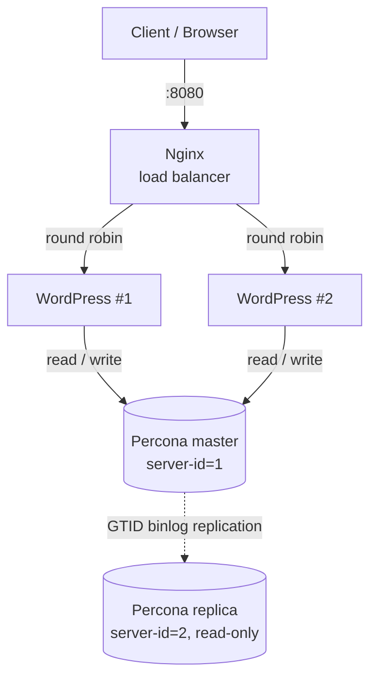

# High-Availability WordPress with Docker Compose

A WordPress setup built for availability: two WordPress instances behind an **Nginx load balancer**, backed by a **Percona Server (MySQL 8) master–replica** pair using GTID-based replication. The whole stack starts with a single `docker compose up`.

## Architecture



| Service      | Container        | Role                                                        | Port          |
|--------------|------------------|-------------------------------------------------------------|---------------|
| `nginx`      | `nginx-balancer` | Reverse proxy that load-balances across both WordPress apps | `8080 → 80`   |
| `wordpress`  | `wordpress-app`  | WordPress instance #1                                       | internal `80` |
| `wordpress2` | `wordpress2-app` | WordPress instance #2                                       | internal `80` |
| `db-master`  | `percona-master` | Primary database; handles all reads and writes              | internal      |
| `db-slave`   | `percona-slave`  | Read-only replica of the `wordpress` database               | `3307 → 3306` |

## Features

- **Load balancing:** Nginx distributes requests round-robin across two WordPress containers (`upstream` block in [`nginx/nginx.conf`](nginx/nginx.conf)). If one instance goes down, Nginx keeps serving traffic from the other.
- **Database replication:** The master writes a binary log with GTIDs (`--gtid-mode=ON`, `--log-bin`). The replica runs with `--read-only=ON` and uses GTID auto-positioning.
- **Health checks** on every service (`mysqladmin ping` for the databases, `curl` for WordPress and Nginx).
- **Self-healing:** `restart: always` on all containers.
- **Persistent storage:** Named volumes for both databases (`db_master_data`, `db_slave_data`).
- **Isolated network:** All services communicate over a dedicated bridge network (`wordpress_net`). Only Nginx and the replica expose ports to the host.
- **Configuration via `.env`:** Images and credentials are kept out of the compose file.

## Tech stack

Docker · Docker Compose · Nginx · WordPress (PHP/Apache) · Percona Server for MySQL 8

## Getting started

### Prerequisites

- Docker and Docker Compose v2

### 1. Clone and start

```bash
git clone https://github.com/djordjedjordjevicc/High-availability-WordPress-system-using-Docker-Compose.git
cd High-availability-WordPress-system-using-Docker-Compose
docker compose up -d
docker compose ps        # wait until services report "healthy"
```

### 2. Enable replication

The compose file configures both servers for GTID replication. The replica still has to be connected to the master once, after the first start. Do this **before** running the WordPress installer.

On the **master**, create a replication user:

```bash
docker exec -it percona-master mysql -uroot -prootpass -e "
  CREATE USER 'repl'@'%' IDENTIFIED BY 'replpass';
  GRANT REPLICATION SLAVE ON *.* TO 'repl'@'%';"
```

On the **replica**, create the database and start replication:

```bash
docker exec -it percona-slave mysql -uroot -prootpass -e "
  CREATE DATABASE IF NOT EXISTS wordpress;
  CHANGE REPLICATION SOURCE TO
    SOURCE_HOST='db-master',
    SOURCE_USER='repl',
    SOURCE_PASSWORD='replpass',
    SOURCE_AUTO_POSITION=1,
    GET_SOURCE_PUBLIC_KEY=1;
  START REPLICA;"
```

Check the status. Both `Replica_IO_Running` and `Replica_SQL_Running` should show `Yes`:

```bash
docker exec -it percona-slave mysql -uroot -prootpass -e "SHOW REPLICA STATUS\G"
```

### 3. Install WordPress

Open **http://localhost:8080** and complete the WordPress installation wizard.

## Testing high availability

**Load balancer failover:** stop one WordPress instance. The site stays available.

```bash
docker stop wordpress-app
curl -I http://localhost:8080     # still returns a response, served by wordpress2-app
docker start wordpress-app
```

**Replication:** create a post in WordPress, then query the replica:

```bash
docker exec -it percona-slave mysql -uroot -prootpass wordpress \
  -e "SELECT ID, post_title FROM wp_posts ORDER BY ID DESC LIMIT 5;"
```

## Project structure

```
.
├── docker-compose.yml   # All services, volumes, network and health checks
├── nginx/
│   └── nginx.conf       # Upstream (load balancing) and proxy configuration
└── .env                 # Images and credentials
```

## Configuration

All settings live in [`.env`](.env):

| Variable                | Default           | Description               |
|-------------------------|-------------------|---------------------------|
| `WORDPRESS_IMAGE`       | `wordpress:latest`| WordPress image           |
| `WORDPRESS_DB_NAME`     | `wordpress`       | Database name             |
| `WORDPRESS_DB_USER`     | `wpuser`          | Database user             |
| `WORDPRESS_DB_PASSWORD` | `wppass`          | Database user password    |
| `PERCONA_IMAGE`         | `percona:8`       | Percona Server image      |
| `MYSQL_ROOT_PASSWORD`   | `rootpass`        | MySQL root password       |
| `NGINX_IMAGE`           | `nginx:latest`    | Nginx image               |

> The credentials in `.env` are demo values for local development. Change them before running this anywhere else.

## Limitations and possible improvements

This is a learning project focused on application-level redundancy and database replication. A production setup would also need:

- **Shared `wp-content` storage:** each WordPress container currently has its own filesystem, so uploaded media and installed plugins are not shared between instances. A shared volume or object storage (e.g. S3) would fix this.
- **Automatic database failover:** WordPress connects only to the master. If the master goes down, the replica must be promoted manually. Tools like Orchestrator or ProxySQL could automate failover and split reads and writes.
- **Automated replication bootstrap:** an init script could run the replication setup from step 2 automatically.
- **HTTPS** termination on Nginx.
- **Secrets management** instead of plain-text credentials in `.env`.
